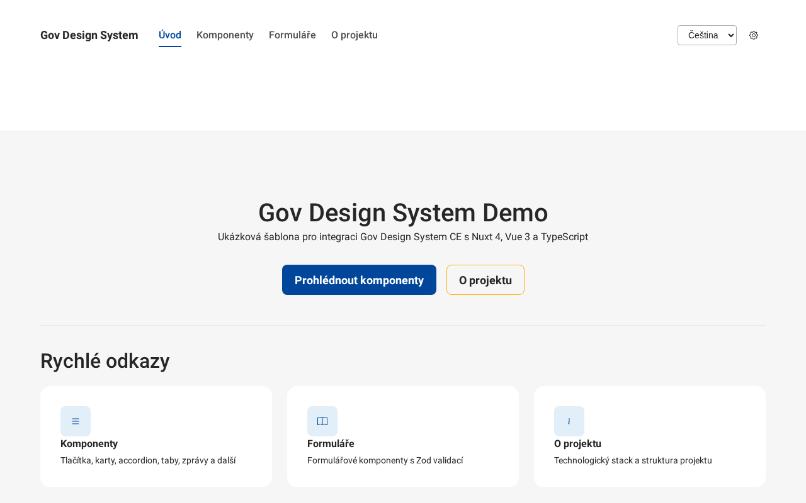
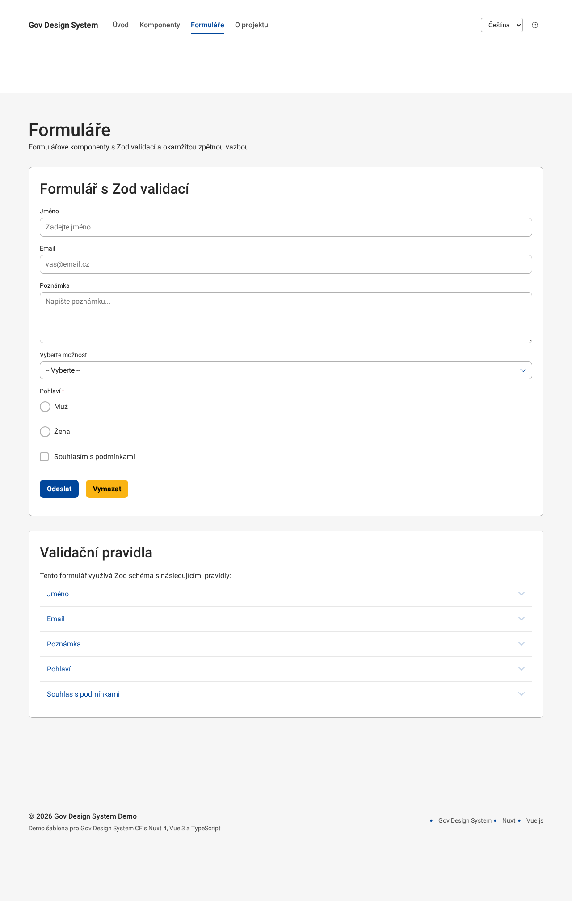

# Gov Design System CE + Nuxt 4

Demo integrace [Gov Design System CE](https://designsystem.gov.cz) s Nuxt 4. Není to oficiální projekt státní správy, jen ukázka, jak design systém napojit.

Co v ní je: čtyři stránky česky a anglicky, formulář s validací (Zod) a souhrnem chyb, světlý a tmavý motiv včetně volby podle systému, a bezpečnostní hlavičky (`nuxt-security`).





## Napojení komponent

### 1. Instalace

```bash
pnpm add @gov-design-system-ce/components @gov-design-system-ce/styles @gov-design-system-ce/fonts @gov-design-system-ce/icons @gov-design-system-ce/vue
```

Ikony si komponenty stahují samy z adresy `iconsPath` (viz plugin níže), takže musí být ve složce `public`:

```bash
cp -r node_modules/@gov-design-system-ce/icons/lib public/icons
```

### 2. Nuxt konfigurace

```typescript
// nuxt.config.ts
export default defineNuxtConfig({
  css: [
    '@gov-design-system-ce/fonts/lib/roboto.css',
    '@gov-design-system-ce/styles/tokens.css',
    '@gov-design-system-ce/styles/styles.css',
    '@gov-design-system-ce/styles/content.css',
    '@gov-design-system-ce/styles/components.css',
  ],
  build: {
    transpile: ['@gov-design-system-ce/vue'],
  },
  vue: {
    compilerOptions: {
      isCustomElement: (tag) => tag.startsWith('gov-'),
    },
  },
})
```

### 3. Pluginy

Client plugin registruje komponenty až po hydrataci (celý je v `app/plugins/design-system.client.ts`):
```typescript
import { ComponentLibrary } from '@gov-design-system-ce/vue/plugin'

export default defineNuxtPlugin((nuxtApp) => {
  window.GOV_DS_CONFIG = {
    iconsPath: '/icons',
    iconsLazyLoad: true,
  }

  nuxtApp.hook('app:suspense:resolve', async () => {
    await ComponentLibrary.install?.(nuxtApp.vueApp)
    passOnEarlyAttributes()
  })
})
```

### Jak spolu žijí Vue a komponenty design systému

Komponenty jsou web components **bez shadow DOM**. Jakmile se vykreslí, přesunou si své potomky do vlastního HTML. Vue o tom neví a s tím souvisí tři pravidla, na kterých demo stojí:

1. **Komponenty se registrují až po hydrataci.** Kdyby si potomky přeskládaly dřív, než Vue převezme stránku ze serveru, Vue by našlo jiný strom, než čeká, komponenty zahodilo a postavilo znovu (v konzoli „Hydration completed but contains mismatches“).
2. **Komponenty se nevykreslují na serveru.** Balíček `@gov-design-system-ce/components` k tomu má skript (`dist/hydrate`), ale jeho výstup Vue při hydrataci nepozná a přestaví ho. Oficiální podpora SSR ve Stencilu pro Vue počítá s Declarative Shadow DOM, který tyhle komponenty nepoužívají. Server tedy pošle obsah (texty, popisky, nadpisy) a vzhled komponent doplní prohlížeč. Aby stránka při tom neposkakovala, drží `app/styles/main.css` formulářovým polím a položkám akordeonu místo, dokud se nevykreslí (`:not(.hydrated)`).
3. **Přímo uvnitř komponenty nic nepřidávejte ani neodebírejte.** `v-if` na přímém potomkovi `GovFormControl` po první změně shodí celý formulář: Vue si drží značku, kam prvek vloží, a komponenta ji mezitím přesunula. Použijte `v-show`, nebo podmínku dejte do obalovacího prvku. Seznamy (`v-for`), které se po načtení nemění, nevadí.

Vlastnosti, které Vue nastaví ještě neregistrované komponentě, skončí jako atributy se špatným názvem (`nativeType` jako `nativetype`, komponenta čte `native-type`). Funkce `passOnEarlyAttributes()` v pluginu je po registraci předá pod správným názvem; bez ní by třeba odesílací tlačítko zůstalo obyčejným tlačítkem.

### 4. Použití komponent

Všechny komponenty se importují z `@gov-design-system-ce/vue` a používají PascalCase:

```vue
<script setup>
import { GovButton, GovFormInput, GovMessage } from '@gov-design-system-ce/vue'

const name = ref('')
</script>

<template>
  <GovFormInput v-model="name" placeholder="Jméno" />
  <GovButton color="primary">Odeslat</GovButton>
  <GovMessage color="success">Úspěch</GovMessage>
</template>
```

Sloty se definují HTML atributem `slot=`, ne Vue direktivou `v-slot`:
```vue
<script setup>
import { GovFormControl, GovFormLabel, GovFormInput } from '@gov-design-system-ce/vue'
</script>

<template>
  <GovFormControl>
    <GovFormLabel slot="top" identifier="name">Jméno</GovFormLabel>
    <GovFormInput v-model="name" identifier="name" />
  </GovFormControl>
</template>
```

Popisek a pole spojuje stejný `identifier`. Bez něj se popisek jen zobrazí vedle pole a čtečka obrazovky pole přečte beze jména. V komponentě, která se na stránce opakuje, ho vygenerujte přes `useId()`.

## Poznámky

- Oficiální design system české státní správy
- Přístupnost řeší komponenty jen zčásti: spojení popisku s polem (`identifier`), souhrn chyb a ohlášení změn čtečce jsou na aplikaci
- Formulářové komponenty podporují `v-model`
- `required` předávejte poli i popisku. Pole ho svému popisku přepisuje, takže popisek označený jako povinný u pole bez `required` po načtení stránky ztratí hvězdičku
- Textarea: `<GovFormInput :multiline="true" :rows="4" />`
- CSP: vyžaduje `style-src 'unsafe-inline'` (Stencil.js generuje inline styly)
- CSP: `script-src` musí povolit inline skript Nuxtu, nejlépe přes nonce (`'nonce-{{nonce}}' 'strict-dynamic'` v `nuxt-security`). Se samotným `'self'` se stránka vykreslí, ale v prohlížeči neoživí, a ve vývojovém režimu se to neprojeví
- `nuxt-security` v produkci odstraňuje výpisy do konzole (`removeLoggers`), pokud to použitý minifikátor umí. Chyby hydratace pak nejsou vidět; při ladění si je zapněte přes `vite.define.__VUE_PROD_HYDRATION_MISMATCH_DETAILS__`
- Znak `|` v překladech odděluje tvary množného čísla. Jako obyčejný znak (třeba v titulku stránky) se píše `{'|'}`
- Čeština má tři tvary množného čísla; pravidlo je v `i18n/i18n.config.ts`

## Spuštění

Potřebujete Node.js 20 nebo novější a pnpm (`corepack enable`).

```bash
pnpm install
pnpm dev          # http://localhost:3000
```

| Příkaz | Co dělá |
|---|---|
| `pnpm build`, `pnpm preview` | produkční sestavení a jeho spuštění |
| `pnpm lint` | ESLint |
| `pnpm typecheck` | kontrola typů |
| `pnpm test` | unit testy (Vitest) |

Produkční sestavení si před nasazením vyzkoušejte v prohlížeči: bezpečnostní hlavičky jsou v něm přísnější než při vývoji.

### Nastavení

| Proměnná | K čemu |
|---|---|
| `NUXT_PUBLIC_SITE_URL` | veřejná adresa webu pro kanonické odkazy a náhledy na sociálních sítích; bez ní se použije adresa, na které stránka běží |

## Struktura

```
app/components   komponenty (demo, form, layout, ui)
app/composables  validace formuláře, přístupnost, SEO
app/schemas      schéma formuláře (Zod)
app/stores       motiv a oznámení (Pinia)
i18n/locales     překlady cs a en
tests            unit testy
```

## Licence

Kód dema je pod [EUPL 1.2](LICENCE), stejně jako Gov Design System CE. Složka `public/icons` je nezměněná kopie ikon design systému (© Digitální a informační agentura); podrobnosti jsou v souboru [NOTICE](NOTICE).

## Nejmenší možný základ

Ve složce [`starters/nuxt`](starters/nuxt) je startér s jednou stránkou a čtyřmi komponentami, postavený podle oficiálního startéru pro Vue. Ukazuje jen to, co Nuxt potřebuje navíc: registraci komponent až po hydrataci. Změřeno na produkčním sestavení: 0 chyb hydratace místo 8.

## Odkazy

- [Gov Design System](https://designsystem.gov.cz)
- [Nuxt](https://nuxt.com)
